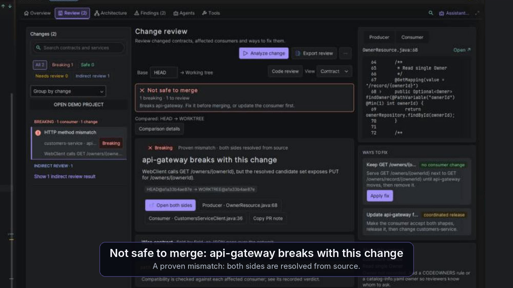

# ArchVerity Demo

**Your service compiles. Does the service calling it still work?**

Find a contract break, inspect both sides, fix it and check again. These open
examples let you evaluate **ArchVerity 5.3.2** on synthetic Java/Spring services
before trying it on your own change. No broker or database is needed for the
static contract scenarios.

**[Start the guided tour →](docs/PRODUCT_TOUR_EN.md)** ·
**[Пошаговый маршрут на русском →](docs/PRODUCT_TOUR_RU.md)** ·
[Install / 14-day trial](https://plugins.jetbrains.com/plugin/34234-archverity)

## Start with a compiling contract mismatch

You need Git, Python 3.10+, JDK 21, a compatible IntelliJ IDEA and a separately
installed ArchVerity with an active Trial/Pro. First dependency downloads need
a network. This repository includes examples, not a plugin binary or licence.

```powershell
git clone https://github.com/lMysticl/ArchVerity-Demo.git
cd ArchVerity-Demo
python -B -X utf8 suite-support/check_suite.py
python -B -X utf8 suite-support/prepare_project.py --project first-result --output ../archverity-first-demo
```

Open **the new `archverity-first-demo` folder** as a Gradle project with JDK 21.
Finish import/indexing. Compile with `.\gradlew.bat classes` (`./gradlew classes`
on Linux/macOS), then choose **Overview → Map this project** in ArchVerity.
The Feign client sends POST; the provider accepts PUT. Open the finding and both
source files, change the caller to PUT, save and refresh analysis. That mismatch
should disappear. Restore POST to confirm it returns.
[Exact files, expected result and recovery](projects/first-result/README.md).

## See what the current product adds

| Question you need answered | Demonstration |
| --- | --- |
| What would break before I edit this field, route or Kafka call? | [Java What-if, then an actual HEAD review](docs/PRODUCT_TOUR_EN.md#2-ask-before-editing-check-the-real-edit-afterward) |
| Can my agent ask before it writes a Kotlin or Java edit? (5.5) | [Ask-before-edit lab: What breaks if…, archverity_simulate_change, then the real edit](projects/ask-before-edit/README.md) |
| Does the proposed fix resolve the affected caller? | [Apply fix and recheck, with compatible and UNKNOWN controls](docs/PRODUCT_TOUR_RU.md#проверить-реальное-изменение-и-применить-исправление) |
| Can a Spring Boot upgrade change our JSON without an API edit? | [New Boot upgrade lab: real mappers, four risks and explicit fixes](projects/boot-upgrade/README.md) |
| What can I show a teammate? | [Copy for my team, review export, registry and recorded CI check](docs/PRODUCT_TOUR_EN.md#4-leave-with-something-your-team-can-use) |
| Can my coding agent check the other service before committing? | [All 18 MCP tools and a before/after workflow](docs/MCP_TOUR_RU.md) |

## Choose the lab for your work

| Project | What you can observe |
| --- | --- |
| [first-result](projects/first-result/README.md) | Compiling Spring MVC/OpenFeign POST–PUT mismatch, source navigation, correction and return control |
| [workspace](docs/ARCHITECTURE_WALKTHROUGH_RU.md) | Java/Kotlin HTTP/Kafka/AMQP, nested DTOs, 19 isolated changes, review/fix and concrete developer-tool inputs |
| [boot-upgrade](projects/boot-upgrade/README.md) | Enum/Month/null/missing-field changes, real Boot 3.5.15 and 4.1.1 JSON, explicit fixes and an unproven-mapper control |
| [ask-before-edit](projects/ask-before-edit/README.md) | Kotlin provider under a context path, Java caller; the answer before a rename or route move equals the review after it (5.5) |
| [kafka-profile-lab](projects/kafka-profile-lab/README.md) | 12 isolated profile/cluster/serializer cases, including equal DTOs and unresolved evidence |
| [api-lab](projects/api-lab/README.md) | Local HTTP/WebSocket/gRPC, captures, assertions, deadlines, cancellation and cookies |
| [runtime-evidence](projects/runtime-evidence/README.md) | Real Actuator input and locally executed verification reports with explicit provenance |
| [mobile-lab](projects/mobile-lab/README.md) | Real Expo/React Native app, Metro/bundle, and separate SDK/device requirements |

**[Documentation index](docs/README.md)** · [All-lab launch runbook](docs/DEMO_RUNBOOK_RU.md) ·
[Capability recipes](docs/FEATURE_CATALOG.md) · [Registered controls](docs/ENTRY_POINTS_RU.md).

## Watch an actual IDE walkthrough

[](https://archverity.hashnode.dev/why-spring-contracts-break-between-repositories-while-everything-still-compiles#a-real-break-in-spring-petclinic-microservices)

[49-second Petclinic walkthrough](https://archverity.hashnode.dev/why-spring-contracts-break-between-repositories-while-everything-still-compiles#a-real-break-in-spring-petclinic-microservices),
recorded with **5.0** ([original MP4 file](docs/media/archverity-5.0-route-break.mp4)). The [HTTP article/video](docs/FIRST_RESULT_ARTICLE_RU.md)
and [Kafka profiles article/video](docs/KAFKA_PROFILES_ARTICLE_RU.md) were recorded
with **3.0.4**. These are historical demonstrations, not recordings of 5.3.2.
The current tour covers the newer actions. [Kafka's six inspectable exports](docs/evidence/kafka-3.0.4/README.md)
retain their original identities.

**Following an older recording?** The current primary tabs are Overview, Review,
Architecture, Findings, Agents and Tools. Use this map when a recording or an
older guide shows a different name:

| Name in the older guide | Where to look in 5.3.2 |
| --- | --- |
| Impact | Review |
| Diagnostics | Findings |
| Topology | Architecture → Map |
| Inventory / Relations | Architecture → Inventory / Relations |

Older verdicts also reflect the analyzer version. Do not use a historical
`UNKNOWN` as the expected outcome of a current run: with a proven affected
caller, moving an HTTP route can be `BREAKING`. In the measured 5.3.2
[`extra-http-path` case](docs/evidence/engine-5.3.2-20261023/shipped-workspace.txt),
the change is `BREAKING`; preserving the old route removes those breaks and
leaves `REVIEW REQUIRED`. Insufficient evidence can still produce `UNKNOWN`.
[Current verification and its limits](docs/CURRENT_VERIFICATION_RU.md) ·
[Пояснение на русском](docs/PRODUCT_TOUR_RU.md#как-читать-старые-записи).

## Полная проверка

The 62 legacy function groups remain as an index; their recipes are refreshed
for the current tour. The registered-control matrix is checked against current
5.3.2 source rather than keeping an obsolete count. Maintainers can run:

```powershell
python -B -X utf8 suite-support/check_suite.py --plugin-source <plugin-source-root> --require-source
python -B -X utf8 -m unittest discover -s suite-support -p 'test_*.py' -v
```

Use the [run record](docs/RUN_RECORD.md) for actual IDEA/device/agent results and
[environment guide](docs/ENVIRONMENT_CHECKS_RU.md) for prerequisites. Input checks,
sample compilation, actual mapper execution and installed-plugin observations
are different evidence. UNKNOWN and a partial check remain visible.
[Dated verification records](docs/VERIFICATION_RU.md) retain their original scope.
[Current checks and the observed retry-listener auto-fix limit](docs/CURRENT_VERIFICATION_RU.md)
include the measured engine results, not just passing input checks.

During the trial, repeat one useful check on your own change: identify a real
consumer, understand the evidence, verify the fix and share the result. That is
the recurring workflow to evaluate before paying.

Sources are synthetic. Caches, local reports, credentials and generated mobile
projects stay out of Git. [Licensing and provenance](NOTICE.md).
