# ArchVerity в картинках

Представьте магазин с двумя программами. Одна принимает заказ, другая проводит оплату. Если платежи начнут требовать новое поле, старая программа заказов всё ещё пошлёт прежний запрос. ArchVerity помогает найти такую пару в IntelliJ IDEA и открыть обе строки кода.

Здесь **сервис** — одна из таких программ. **Контракт** описывает их договорённость о том, по какому адресу обратиться и какие данные передать. **Потребитель** — тот, кто рассчитывает на эту договорённость.

**Для первого знакомства** пройдите три шага ниже. **Если у вас уже есть задача**, выберите её в таблице. В [полном каталоге функций и команд](FEATURE_CATALOG_RU.md) есть также возможности редактора, команды для терминала и инструменты, доступные помощнику.

Основные снимки ниже сделаны в **ArchVerity 6.1.0**. Две картинки платёжного примера взяты из галереи Marketplace. Нажмите на изображение, чтобы прочитать мелкие надписи.

<a id="whats-new"></a>

## Что нового в 6.1.3

Выпуск от **6 ноября 2026 года**. Откройте **Changes → Summary → Check Changes**, затем **Details**, чтобы увидеть, кого затронула правка.

- **Удалили адрес, а магазин всё ещё отправляет туда запросы.** Магазин по-прежнему вызывает `/pay`. В той же правке разработчик удалил этот адрес в платёжном сервисе и переименовал файл магазина, который отправляет запрос. Теперь ArchVerity находит вызов и показывает **Breaking**. То же правило действует, если поменяли топик Kafka, а программа всё ещё ждёт сообщения в старом.
- **Просто переложили код в другой файл.** Если адрес, способ вызова и поля сообщения остались прежними, перенос контроллера или класса с данными сам по себе сохраняет договорённость. Если при переносе изменили поле, ArchVerity всё равно проверяет, сможет ли другая программа прочитать его.
- **Помощник собирается сделать коммит.** Если Git не может точно определить, какие файлы попадут в коммит, защита просит подтверждение. Она также распознаёт `git.exe` и продолжение слияния или перебазирования через `--continue`.

Выберите пакет для своей IDEA: [основной 6.1.3](https://plugins.jetbrains.com/plugin/34234-archverity--spring-microservice-contract-checker/versions/stable/1213640) или [6.1.3 для IDEA 2024.3](https://plugins.jetbrains.com/plugin/34234-archverity--spring-microservice-contract-checker/versions/stable/1213641). На каждой странице есть полное описание изменений.

| Я хочу… | Куда перейти |
| --- | --- |
| Узнать, кого заденет моя правка | [Changes и Details](#changes) |
| Проверить идею до изменения кода | [Прогноз прямо из редактора](#what-if) |
| Понять, кто к кому обращается | [Map — карта, список и связи](#map) |
| Найти проблему, которая уже есть в коде | [Problems](#problems) |
| Проверить сообщения, обновление сервисов или удаление столбца | [Kafka](#kafka) · [Порядок обновления](#rollout) · [База данных](#database) |
| Показать результат коллеге или подключить своего помощника | [Отчёт](#export) · [Agents](#agents) |
| Послать запрос, прочитать SQL, открыть журнал или сертификат | [Девять инструментов Tools](#tools) |

<a id="start"></a>
## Первый пример в три шага

**1. Откройте пример.** В IDEA выберите **View → Tool Windows → ArchVerity**. В разделе **Changes → Summary** нажмите **… → Open Demo Project**. При первом запуске также может появиться кнопка **Try the Demo**. Выберите папку для примера и дождитесь загрузки проекта. Для проверки контрактов нужен действующий Trial или Pro.

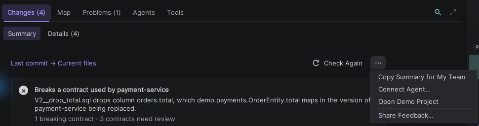

**2. Найдите недостающее поле.** Во встроенном примере оставьте базу **HEAD** — это последняя сохранённая в Git версия. Нажмите **Check Changes**. Платежи теперь требуют поле `priority`, а сервис заказов его не отправляет. В **Details** выберите замечание и нажмите **Open Both Sides**, чтобы увидеть, где расходятся два файла.

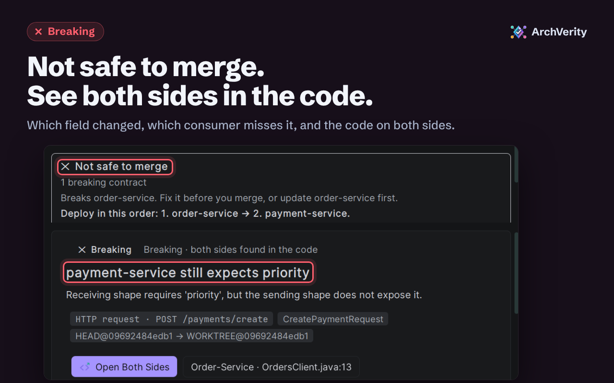

**3. Проверьте исправление.** Для простого опыта уберите новое требование в учебном коде платежей, чтобы прежний запрос снова подходил. Сохраните файл и нажмите **Check Again**. Надпись **No breaking changes found** означает, что в выбранном сравнении плагин больше не нашёл поломку. На снимке из галереи показан также вариант, где `priority` сделали необязательным.

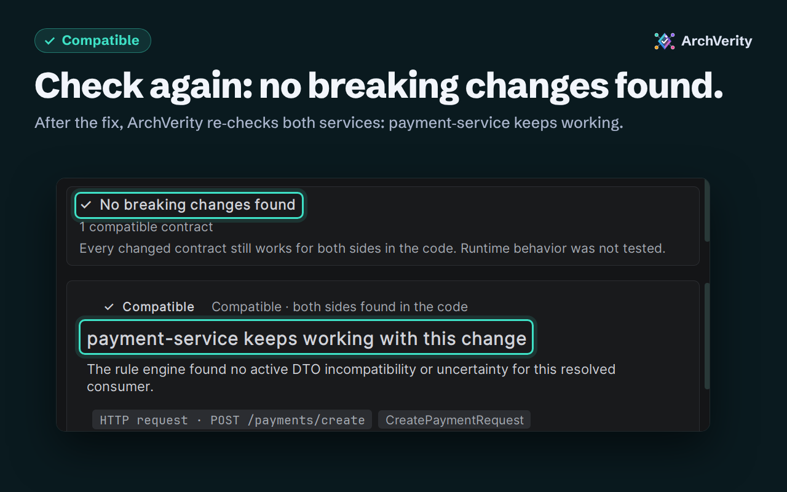

Дальше разберём другой учебный проект. Из таблицы заказов удаляют столбец `total` — сумму заказа. Старая версия сервиса платежей всё ещё читает этот столбец. На следующих экранах можно проследить это изменение от предупреждения до строки в коде.

<a id="changes"></a>
## Changes — кого затронет правка?

Нажмите **Changes → Summary**. Прочитайте заголовок первой карточки, затем строку **Affected Services**. На снимке ArchVerity называет `payment-service`. Файл `V2__drop_total.sql` удаляет столбец `orders.total`, который сервис ещё использует.

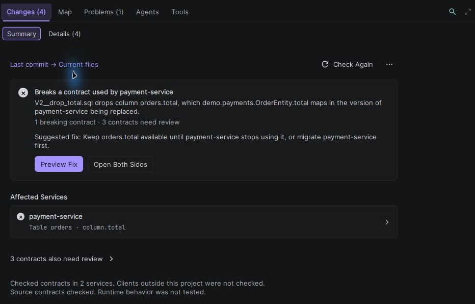

**Breaking** — найдены две стороны, которые расходятся. **Needs review** — для ответа не хватает сведений, и карточка подсказывает, что уточнить. **Compatible** — проверенная связь согласуется в этом сравнении. Внизу Summary видно, какие сервисы попали в проверку.

<a id="details"></a>
### Details — где это видно в коде?

Откройте **Changes → Details → Breaking → Open Details**. В карточке нажмите **Open Both Sides**. На снимке две кнопки ведут к точным строкам. Слева `V2__drop_total.sql:1` удаляет столбец, справа `OrderEntity.java:16` указывает, где его читала предыдущая версия.

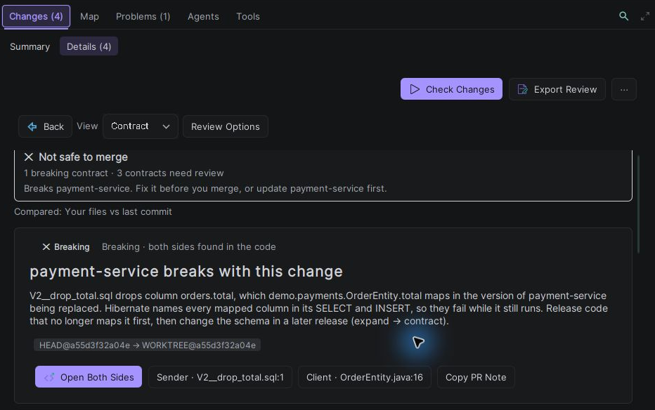

<details>
<summary>Как найти нужную карточку, посмотреть подсказку и проверить исходную версию</summary>

В **Details** выберите **Breaking** или **Needs Review**. Для длинного списка используйте поиск по контракту или сервису. В примере четыре результата, из них один доказанный разрыв.

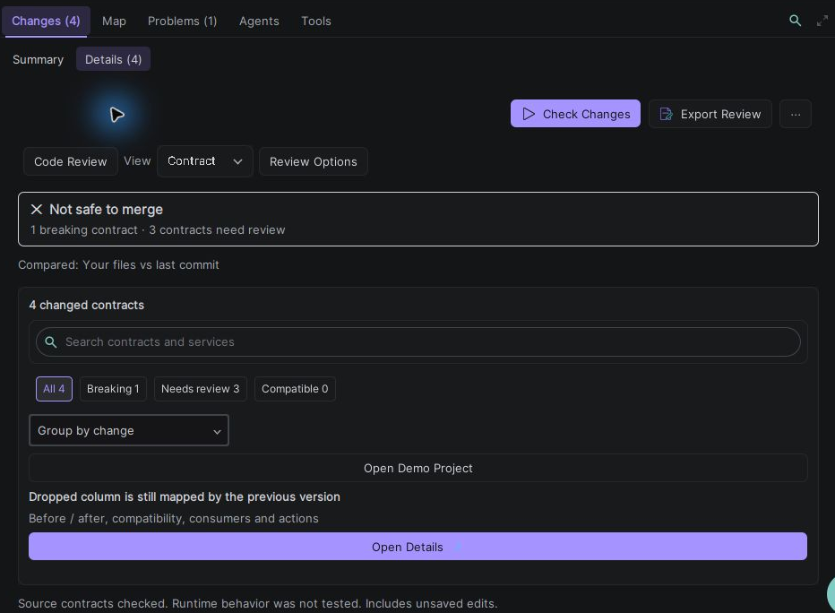

Прокрутите карточку до **Suggested Fixes**. Для этой миграции сначала нужно выпустить версию `payment-service`, которая обходится без `total`, затем удалять столбец. Для изменений, у которых доступно **Preview Fix**, сначала посмотрите предлагаемую правку и затем проверьте результат ещё раз.

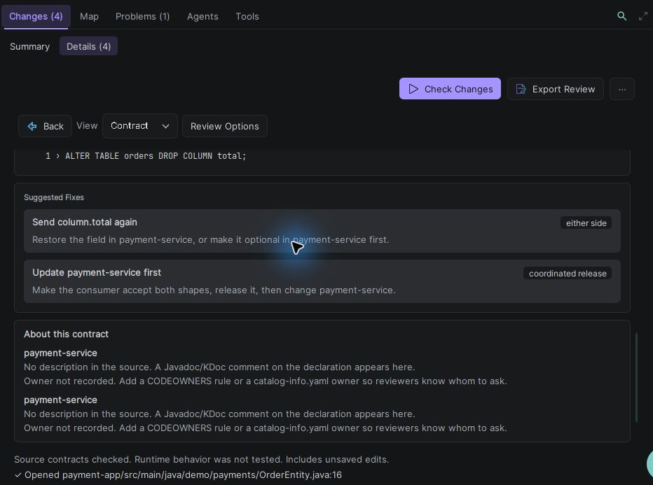

Чтобы узнать, какие файлы сравнивались, нажмите **Review Options → Comparison Details**. Здесь показаны Git-версия и текущие файлы. Для папки с несколькими репозиториями это место показывает базу каждого участника. **Compare with Production** использует указанную в проекте Git-версию. Какие версии действительно запущены, уточняют отдельно.

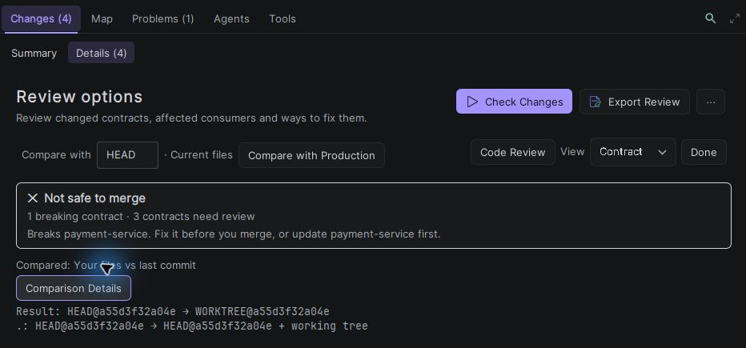

Для поддерживаемой проверки Java и JSON внизу карточки есть **Replay with Real Jackson (Experimental)**. Это отдельный опыт с собранными классами и примером данных. На снимке показано, где его запустить.

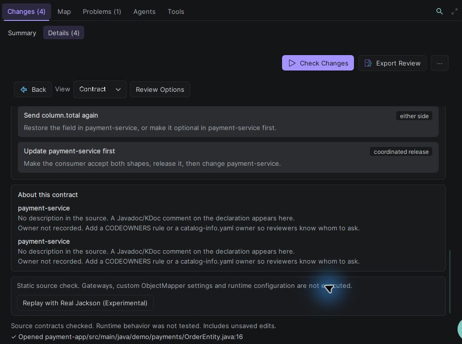

</details>

<a id="what-if"></a>
## Что сломается, если изменить адрес?

В файле Java или Kotlin щёлкните правой кнопкой по поддержанному полю или методу. Выберите **ArchVerity: What Breaks If This Changes?**. В этом примере мы выбрали маршрут оплаты. Над методом IDEA уже показывает **1 caller in order-service** — одно место, откуда приходит вызов.

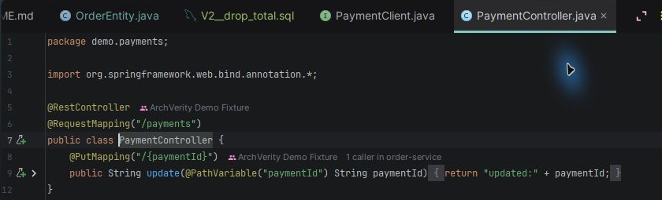

В окне **Impact Preview** написано, что перенос адреса сломает один вызов. Нажмите ссылку **PaymentClient.java:9**, чтобы найти его. Можно заранее решить, как сохранить старый адрес на время перехода. Прогноз оставляет файлы в их текущем виде.

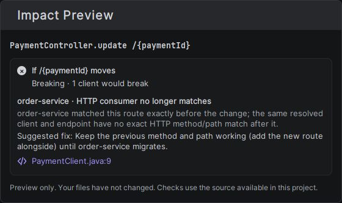

<a id="map"></a>
## Map — кто к кому обращается?

Нажмите **Map → Analyze Project → Graph**. Начните с двух прямоугольников. Сервис `order-service` отправляет запрос, `payment-service` его принимает. Выберите прямоугольник или стрелку, и справа появится объяснение. Кнопка **Focus mode** помогает оставить на карте ближайшие связи одного сервиса.

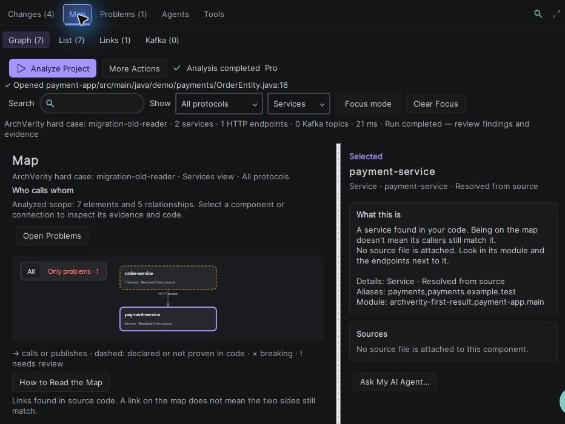

<details>
<summary>Найти один объект в списке или прочитать конкретную связь</summary>

**Map → List** удобен, когда вы знаете имя. В примере видны `PaymentClient`, `PaymentController` и маршрут `PUT /payments/{paymentId}`.

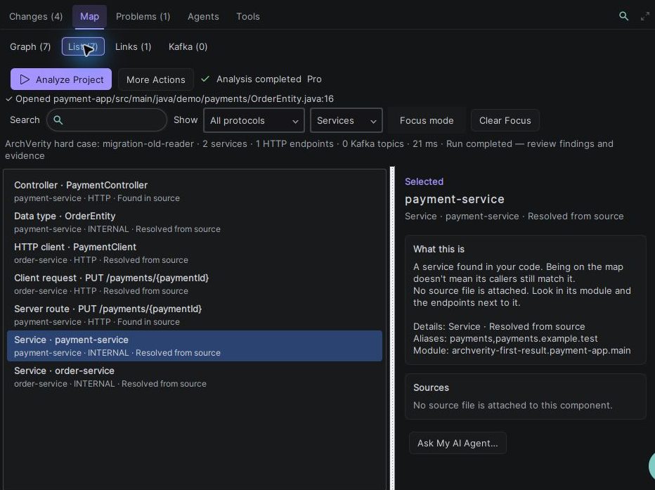

**Map → Links** показывает пары. Нажмите строку **Matches route**, и справа появится объяснение, какому адресу соответствует вызов. Это совпадение метода и пути в исходниках. Ответ запущенного сервера можно проверить отдельно в [API Client](#api).

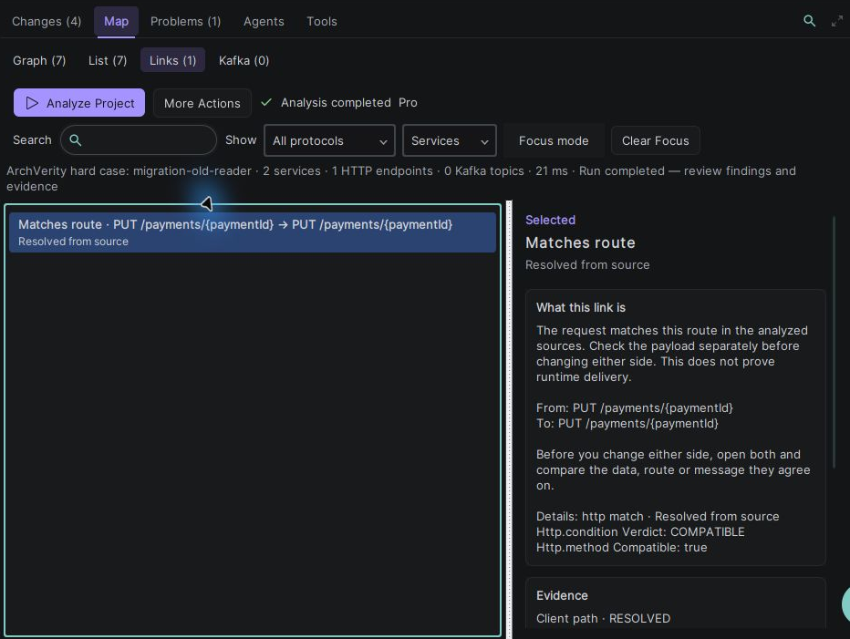

</details>

<a id="problems"></a>
## Problems — что уже стоит проверить?

Откройте **Problems** после анализа. В нашем примере у `PaymentClient` не задано время ожидания ответа. Это **Note** — повод настроить поведение клиента, если платежи отвечают медленно. Нажмите **PaymentClient.java:7** под текстом, чтобы перейти к нему. Сломался ли именно ваш новый код, смотрите в **Changes**.

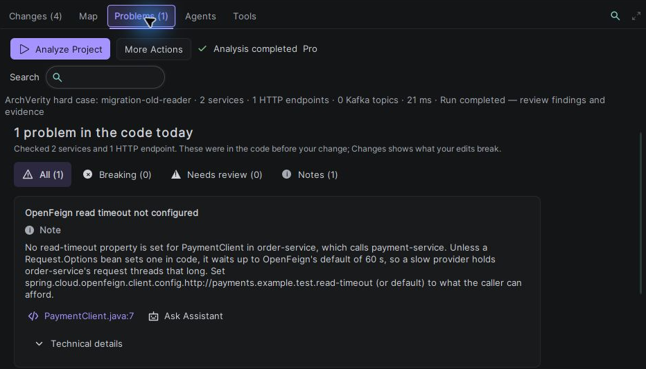

<details>
<summary>Какие маршруты особенно важны и что проверить перед переходом на Spring Boot 4</summary>

Прокрутите до **Across your project**. На снимке один сервис обращается к `PUT /payments/{paymentId}`. Здесь видно, сколько сервисов зависят от маршрута, и можно открыть его строку в коде.

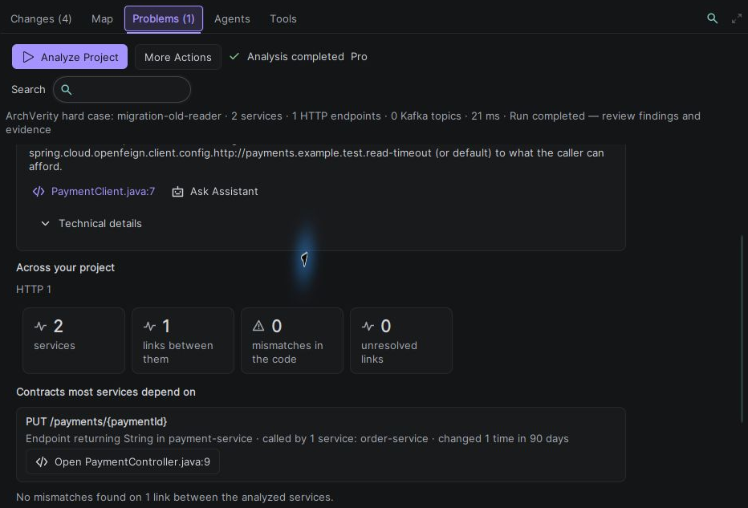

Внизу **Problems** нажмите **Check Spring Boot 4 Upgrade**. В этом учебном проекте плагин смог разобрать один поток данных, но не нашёл библиотеку Jackson ни в одном из двух модулей. Именно так выглядит ответ, когда для оценки перехода не хватает данных.

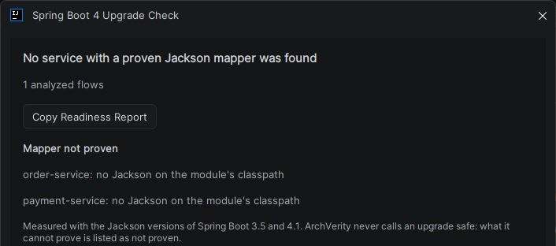

</details>

<a id="kafka"></a>
## Kafka — сможет ли новый получатель прочитать старое сообщение?

Представьте письмо старого образца. Новый получатель требует поле `tenant`, но раньше его не было. В учебном примере **Changes → Summary** показывает два разрыва. Когда поле становится необязательным, та же проверка показывает два совместимых контракта.

**До.** Получатель требует поле, которого в старом сообщении нет.

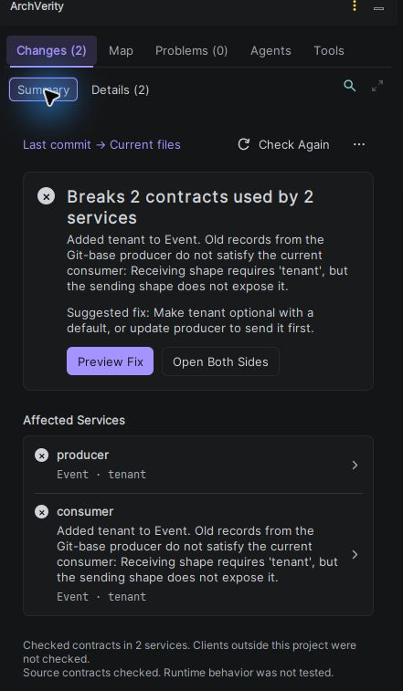

**После.** Получатель допускает отсутствие поля. В тех же двух контрактах больше нет доказанных разрывов.

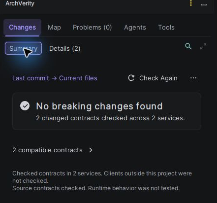

<details>
<summary>Где посмотреть, кто отправляет и кто читает сообщения</summary>

Откройте **Map → Kafka**. Если в проекте подготовлены наблюдения за работающим приложением, **Import…** позволяет просмотреть и добавить их. Затем выберите строку **Producer → Consumer** и нажмите **Inspect Pair**. Список на снимке пуст, потому что в проекте миграции баз данных сообщения Kafka не собирали. [Как повторить пример с сообщениями](../projects/hard-cases/README.md)

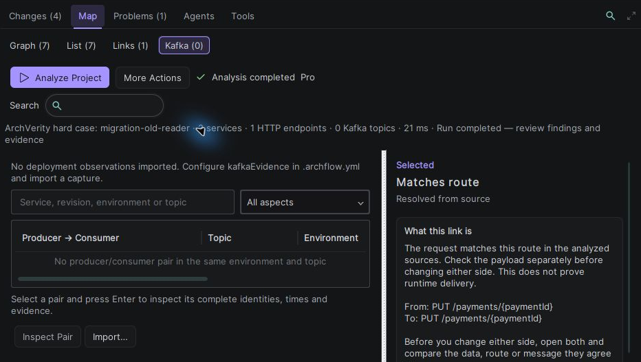

</details>

<a id="rollout"></a>
## В каком порядке обновлять два сервиса?

Новый сервис заказов и новый сервис платежей договорились об адресе `/v2/payments/{paymentId}`. Но в момент обновления один из них всё ещё будет старым. В **Changes → Details** обратите внимание на строку **As written, no deploy order is safe**. Какой бы сервис ни обновили первым, один из запросов уйдёт по адресу, которого другая сторона не знает.

**Если сразу заменить адрес.** Оба новых сервиса согласны между собой, но в предупреждении уже виден риск для старых версий.

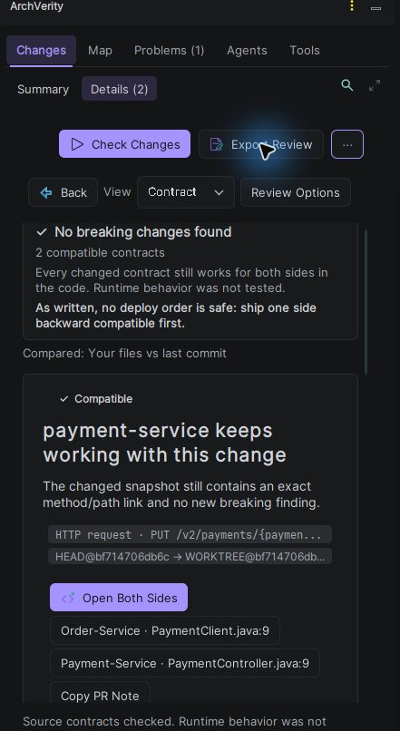

**Если сначала сохранить оба адреса.** Добавьте новый адрес рядом со старым в платежах, затем переведите на него заказы. В примере после этой правки остаются две связи, которым нужна ручная проверка.

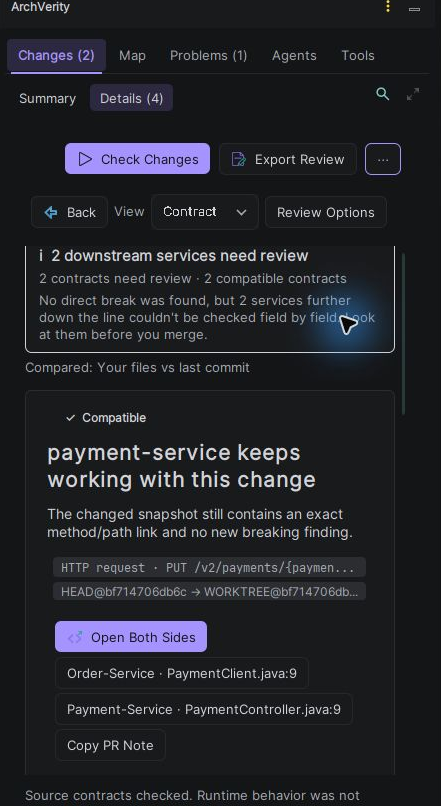

**Export Review → Copy rollout plan** позволяет прочитать шаги и то, что ещё нужно проверить. [План до изменения](evidence/hard-cases-6.1.0/rollout-no-order.md) · [План после добавления адреса](evidence/hard-cases-6.1.0/rollout-expanded-review.md)

<a id="database"></a>
## База данных — можно ли уже удалить столбец?

Вернёмся к столбцу `orders.total` из [первой карточки Changes](#changes). В этом примере старый код всё ещё читает сумму заказа. Если отложить удаление, прежняя поломка исчезает. На новом снимке остаётся **1 contract needs review** — другую часть изменения ещё предстоит проверить. [Файлы и шаги для повторения](../projects/hard-cases/README.md)

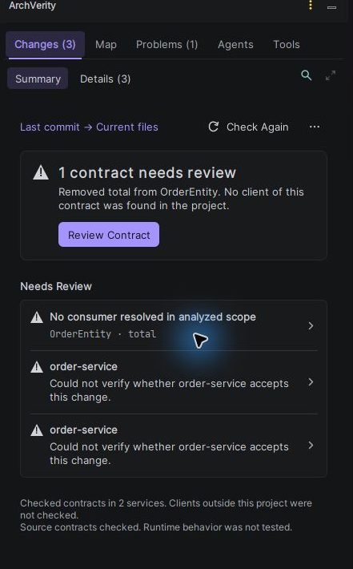

<a id="export"></a>
## Как показать результат коллеге?

Откройте **Changes → Details → Export Review**. **Copy review summary** копирует короткий итог, **Copy notes for affected teams** — заметки для затронутых команд, **Copy rollout plan** — порядок перехода. Текст можно сначала прочитать и затем отправить коллеге самостоятельно.

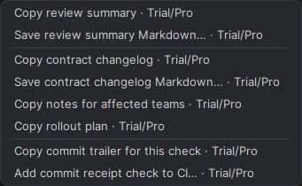

Нужен файл для другой программы? Кнопка **…** рядом с **Export Review** открывает **Copy or save JSON…** и дополнительные форматы. Через это же меню можно сохранить базу сравнения.

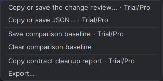

<a id="agents"></a>
## Agents — что уже проверял помощник?

Откройте **Agents**. На снимке история ещё пуста. Кнопка **… → Check Current Changes** начинает новую локальную проверку, а **Refresh History** перечитывает прежние записи. Раздел **Needs attention** помогает найти проверки, на которые стоит посмотреть.

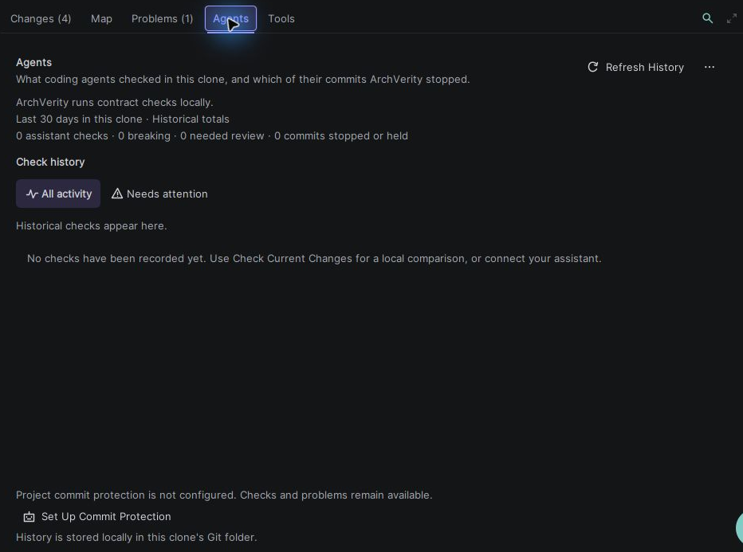

<details>
<summary>Как подключить своего помощника, открыть ревью или проверить коммиты</summary>

**… → Review Project with Assistant…** запускает отдельный сценарий ревью с выбранным помощником. **Copy Value Report** собирает сведения из истории, а **Your Estimate…** позволяет задать собственную оценку.

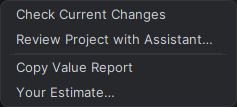

**Changes → Summary → … → Connect Agent…** открывает окно подключения. Можно выбрать помощника для ревью или связать агент с IDEA через MCP — так он сможет задать плагину, например, вопрос «Кто вызывает этот маршрут?». Внизу окна есть инструкция для первого запроса. Ответ должен назвать нужный проект. [Все 19 команд помощника и их назначение](FEATURE_CATALOG_RU.md)

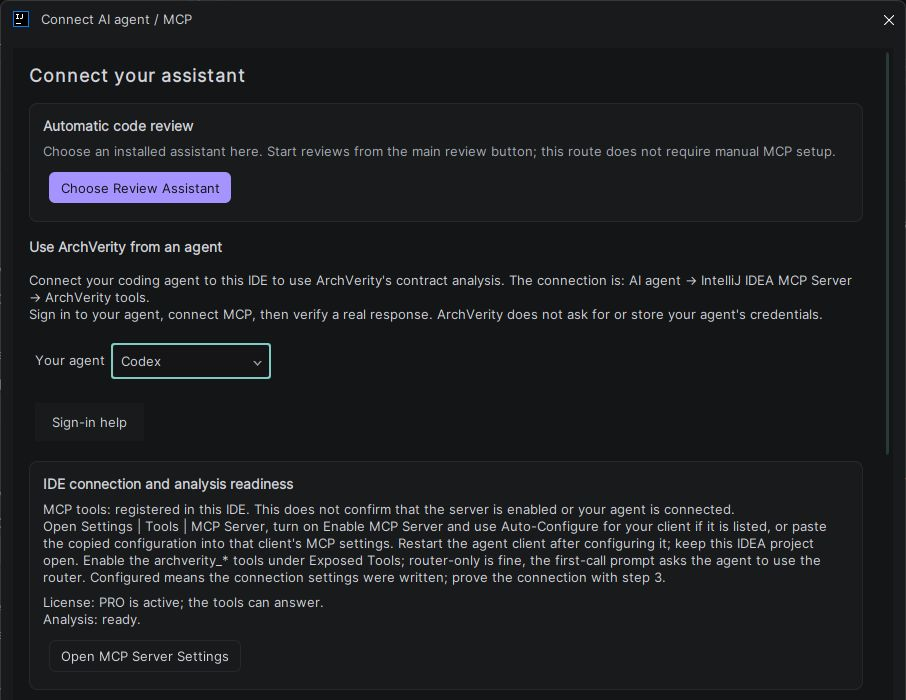

**Agents → Set Up Commit Protection → Optional rules and commit checks** показывает, какие правила и проверки можно включить в этом проекте перед коммитом. На снимке видны отдельные варианты для разных помощников. Возможности MCP ArchVerity и встроенная проверка коммита IDEA относятся к современному пакету плагина.

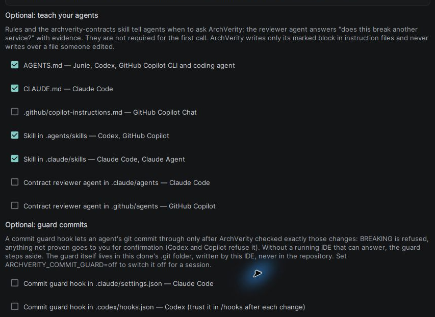

В меню самой IDEA **Tools → ArchVerity: AI Settings Assistant…** есть отдельный мастер. В нём указывают профили, включённые модули и исключённые папки. Нажмите **Preview Change**, чтобы увидеть предлагаемые изменения настроек до применения.

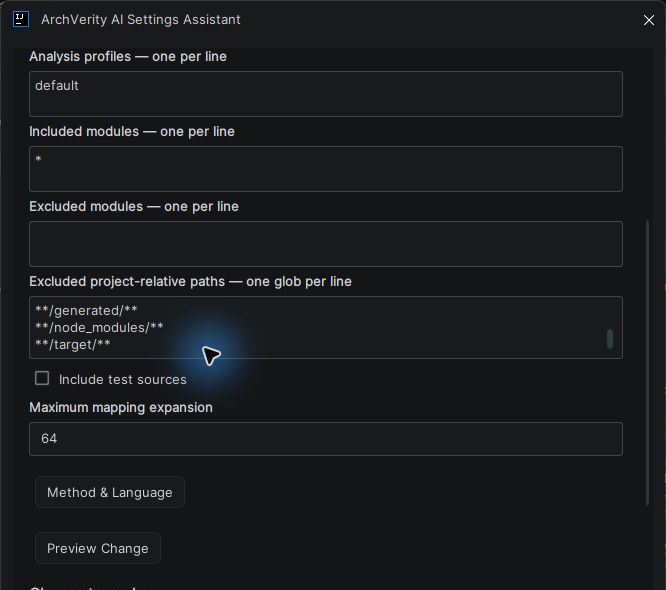

</details>

<a id="tools"></a>
## Инструменты для работы с кодом

Откройте **ArchVerity → Tools**. Выберите инструмент в списке. Когда откроется его панель, сверху появится ряд кнопок для перехода между девятью инструментами. Например, если в журнале вместо числа виден знак вопроса, выберите **MyBatis SQL**. Если хотите проверить, отвечает ли ваш сервис, выберите **API Client**.

[Spring](#spring) · [MyBatis SQL](#mybatis) · [Ansible](#ansible) · [Shell и Bats](#shell) · [API Client](#api) · [React Native](#react) · [Журналы](#logs) · [Значки](#icons) · [Сертификаты](#keystore)

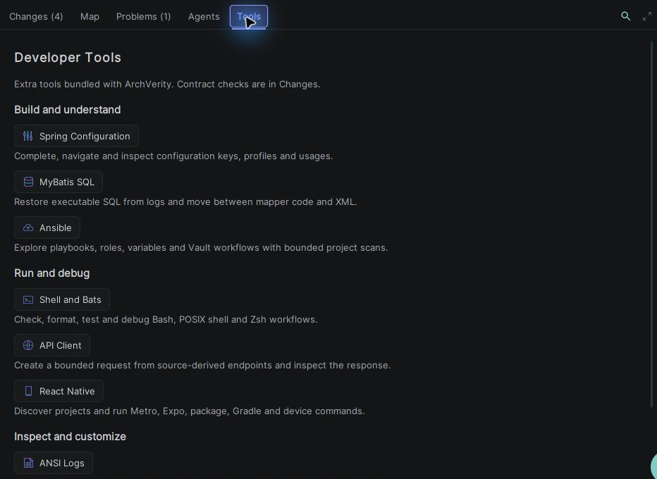

<a id="spring"></a>
### Spring config — где задана настройка?

Выберите **Spring config → Inspect Spring config**. На снимке инструмент просмотрел семь файлов и показывает ноль ключей. Чтобы попробовать пример с известным значением, откройте демопроект `projects/workspace`, повторите проверку и найдите `server.port`. Выберите строку и нажмите **Enter**, чтобы перейти к объявлению. В модуле `payment-app` увидите `8085` — порт этого сервиса. [Файл с настройкой](../projects/workspace/payment-app/src/main/resources/application.yml)

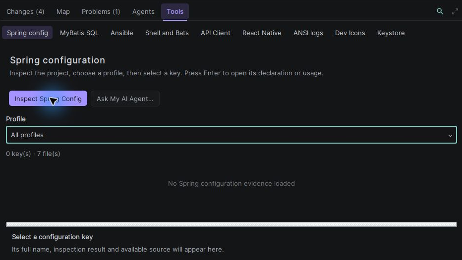

<a id="mybatis"></a>
### MyBatis SQL — что стоит вместо знаков вопроса?

На снимке обе области пустые. Вставьте эти две строки в верхнее поле **Log lines** и нажмите **Reconstruct SQL**.

```text
Preparing: SELECT * FROM payments WHERE id = ? AND status = ?
Parameters: 42(Long), O'Reilly(String)
```

В нижнем поле получится `SELECT * FROM payments WHERE id = 42 AND status = 'O''Reilly'`. Так видно, какие значения приложение подставило в запрос. Инструмент собирает текст локально. [Программа, которая печатает эти две строки](../projects/workspace/mybatis-console-fixture/src/main/java/sample/mybatis/MyBatisConsoleFixture.java)

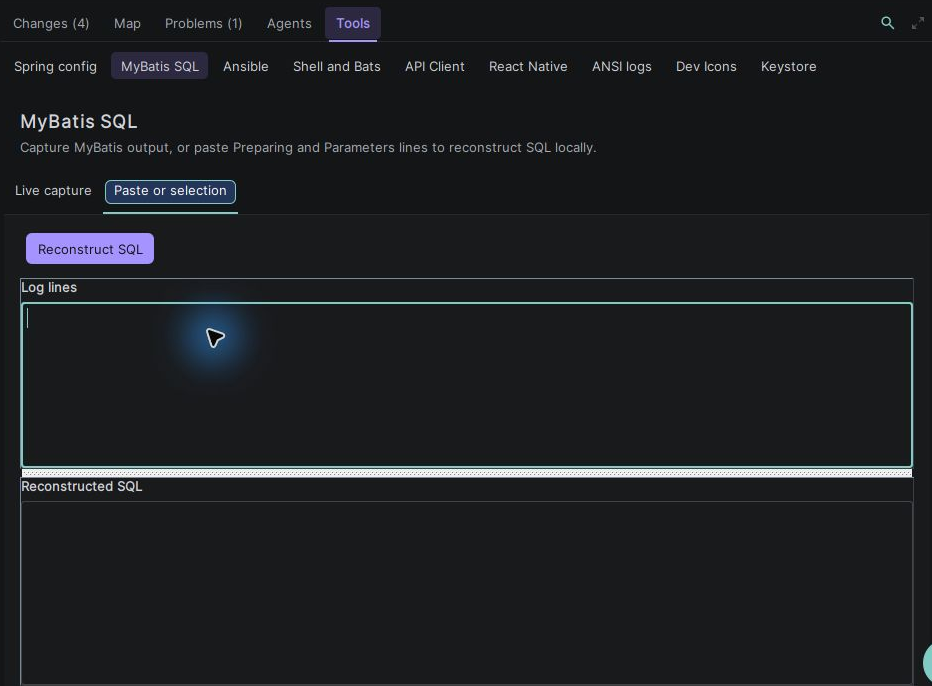

<a id="ansible"></a>
### Ansible — какие задачи выполняет сценарий?

Откройте `projects/workspace`, выберите **Ansible → Scan project**. На снимке виден экран до первого сканирования. После него ищите сценарий `ansible/playbook.yml`. В нём задача **Check endpoint** проверяет адрес `/actuator/health` и ожидает ответ `200`. По кнопке **Go to source** можно открыть выбранную строку в файле. [Сценарий с этой задачей](../projects/workspace/ansible/playbook.yml)

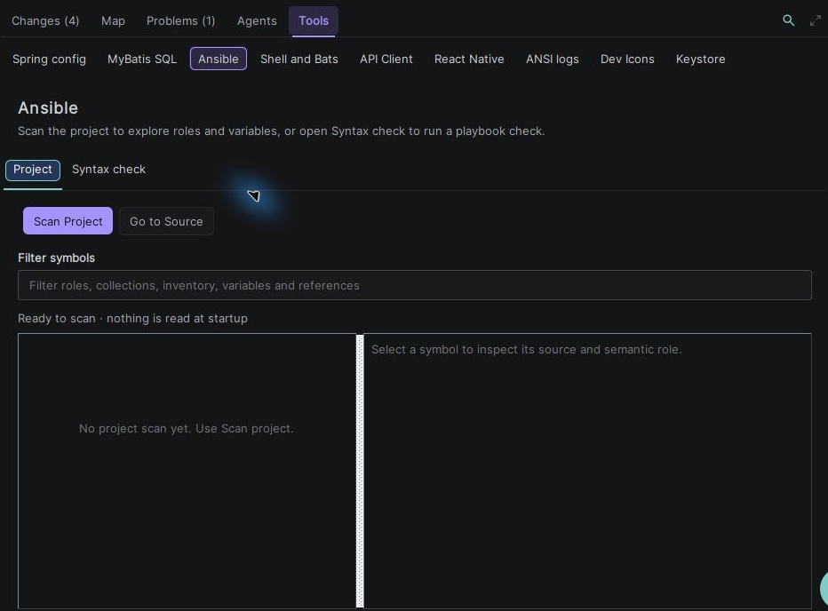

<a id="shell"></a>
### Shell and Bats — как проверить командный файл?

На снимке выбран **ShellCheck**. Укажите путь `shell-tools/format.sh` относительно демопроекта `projects/workspace` и нажмите **Start**. ShellCheck читает скрипт и выводит замечания. Для запуска команда ShellCheck должна быть установлена. В этом же списке можно выбрать **Bats** и открыть `shell-tools/sample.bats`. В файле два теста, первый проходит, второй специально завершается ошибкой. Для этого примера нужны Bash и Bats. [Скрипт](../projects/workspace/shell-tools/format.sh) · [Два теста Bats](../projects/workspace/shell-tools/sample.bats)

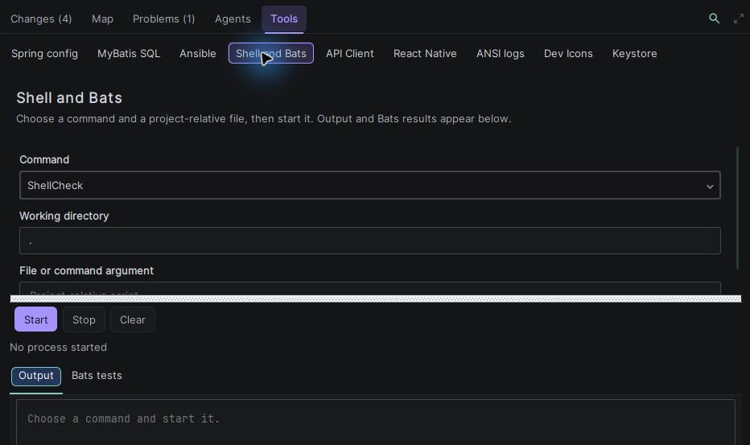

<a id="api"></a>
### API Client — что отвечает сервис?

**HTTP.** На снимке запрос ещё не отправлен. Чтобы попробовать на своём компьютере, в корне репозитория **ArchVerity-Demo** запустите `python projects/api-lab/serve.py --protocol http` (Python 3.10 или новее). В **API Client → HTTP** выберите `GET`, введите `http://127.0.0.1:18427/items/42` и нажмите **Send request**. Пока локальный сервер работает, этот адрес возвращает запись с номером `42`. [Готовые запросы](../projects/api-lab/requests.http)

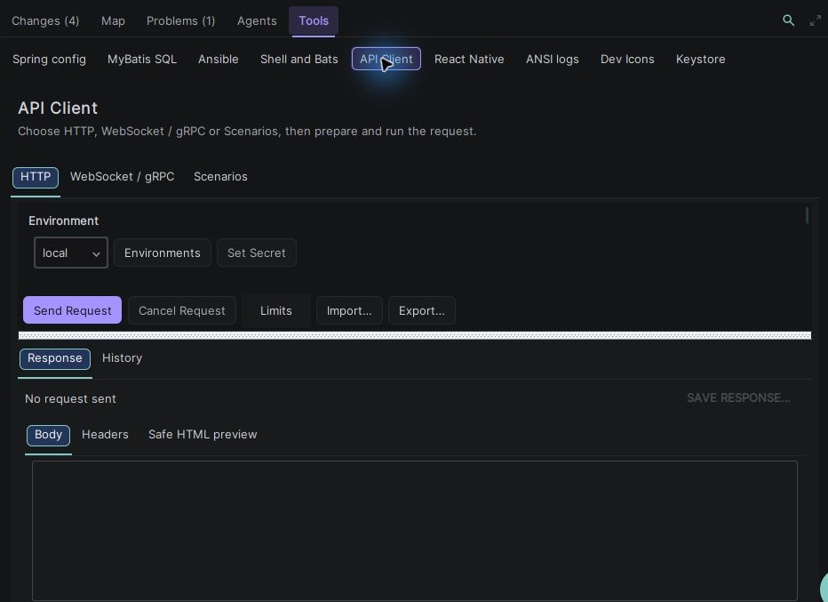

**WebSocket / gRPC.** Откройте эту вкладку, если нужно обмениваться сообщениями с сервисом. На снимке соединение ещё не открыто. Для примера запустите WebSocket-сервер лаборатории, укажите `ws://127.0.0.1:18428`, нажмите **Connect** и отправьте слово `Привет`. Сервер возвращает тот же текст. Для gRPC в этой же вкладке выбирают описание сервиса и имя метода. [Как запустить оба сервера](../projects/api-lab/README.md)

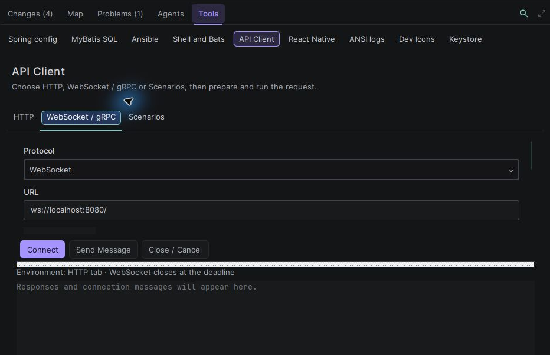

**Scenarios.** Здесь можно выполнить от 1 до 20 запросов по порядку. Вставьте содержимое `happy.json` и нажмите **Run scenario** при работающем HTTP-сервере. В примере первый шаг читает номер `42`, второй отправляет его обратно и проверяет ответ. На снимке показана форма до запуска. [Пример из двух шагов](../projects/api-lab/scenarios/happy.json)

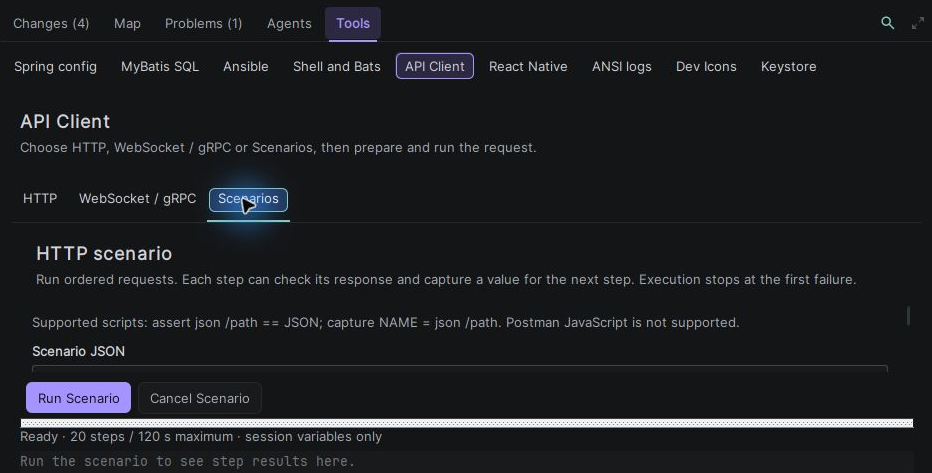

<a id="react"></a>
### React Native — как найти команды мобильного приложения?

На снимке мобильный проект ещё не выбран. Откройте папку `projects/mobile-lab` и нажмите **React Native → Detect projects**. Выберите найденное приложение и посмотрите список команд. Например, `start` запускает Expo, а `metro` запускает сборщик JavaScript. Для поиска достаточно файлов проекта. Для запуска команды понадобятся установленные зависимости приложения. [Команды из package.json](../projects/mobile-lab/package.json) · [Подготовка лаборатории](../projects/mobile-lab/README.md)

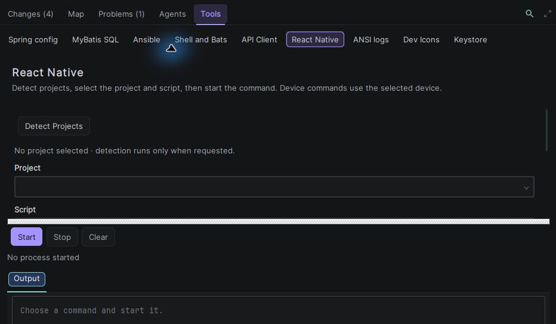

<a id="logs"></a>
### ANSI logs — как прочитать цветной журнал?

В **ANSI logs** показана подсказка. Откройте `archflow-live.ansi` в редакторе IDEA. Найдите строку `ERROR Payment failed`. При обычном чтении виден цвет сообщения, а в исходном виде — служебные символы, которые задают этот цвет. Большие журналы можно листать по страницам, кнопка **Tail** ведёт к концу файла. [Журнал для примера](../projects/workspace/archflow-live.ansi)

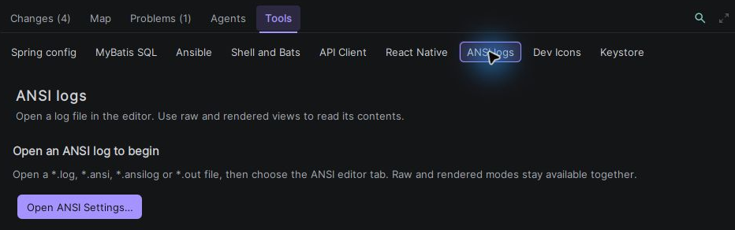

<a id="icons"></a>
### Dev icons — как выбрать значки файлов?

В **Dev icons** сравните три встроенных набора — **Studio**, **Outline** и **Contrast**. Нажмите **Use this set** рядом с понравившимся набором. Проверьте значки файлов в дереве проекта. Если у вас уже есть свой набор, его можно открыть кнопкой **Import .aficons…**. [Демонстрационный набор значков](../projects/workspace/archverity-qa.aficons)

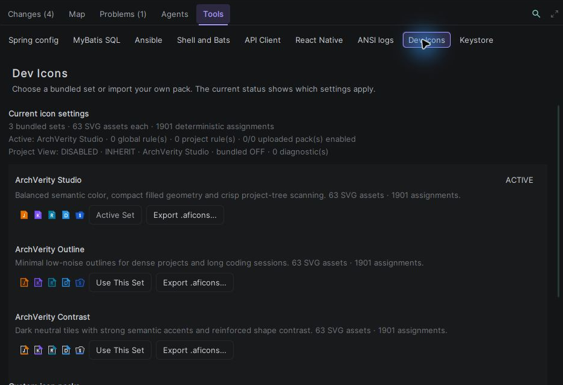

<a id="keystore"></a>
### Keystore — кому выдан сертификат и когда истекает его срок?

Нажмите **Keystore → Select artifact…** и выберите учебный `qa-cert.pem`. В окне проверки найдите владельца сертификата, того, кто его выдал, и срок действия. На снимке виден первый шаг — выбор файла. Для этой пробы достаточно публичного сертификата из демопроекта. [Учебный сертификат](../projects/workspace/qa-cert.pem)

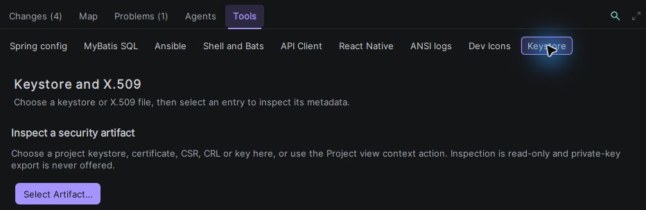

## Где узнать больше

[Полный каталог функций и команд](FEATURE_CATALOG_RU.md) · [Учебные проекты и их запуск](DEMO_RUNBOOK_RU.md) · [Статья на английском](https://archverity.hashnode.dev/why-spring-contracts-break-between-repositories-while-everything-still-compiles)

Снимки вкладок, меню и диалогов сделаны 6 ноября 2026 года в IntelliJ IDEA 2026.1.4 с ArchVerity 6.1.0. В примерах Kafka, порядка обновления и отложенной миграции использованы также кадры той же версии от 5 ноября. На изображениях оставлен фрагмент окна в исходном масштабе. [Происхождение снимков](media/visual-guide-6.1.0/captures.json) · [Шесть исходных кадров с результатами проверок](evidence/hard-cases-6.1.0/native-run.json).
